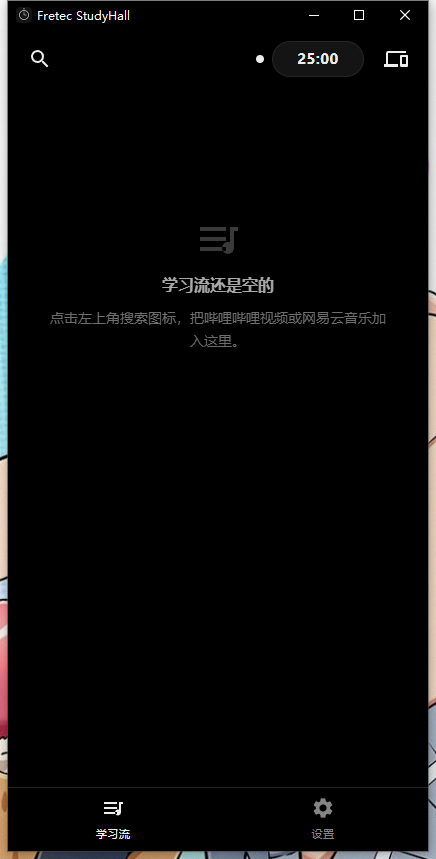
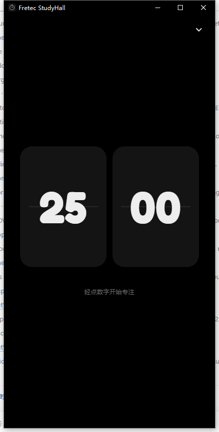
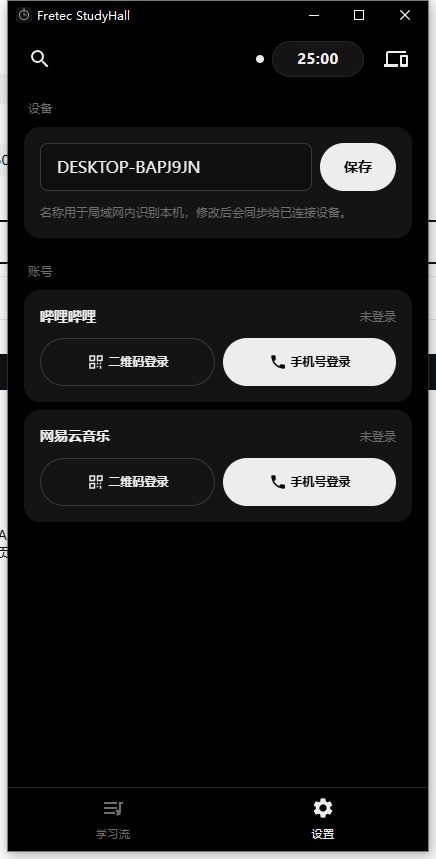
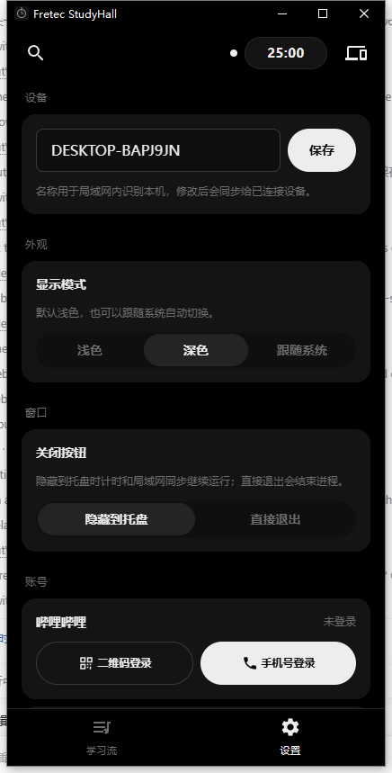
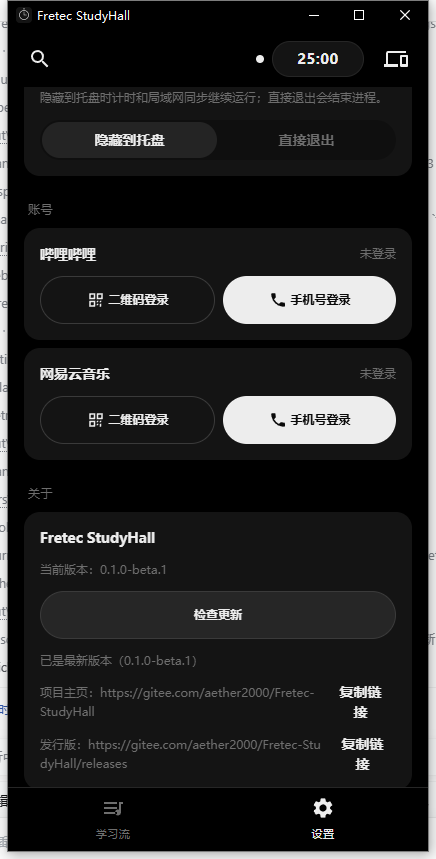
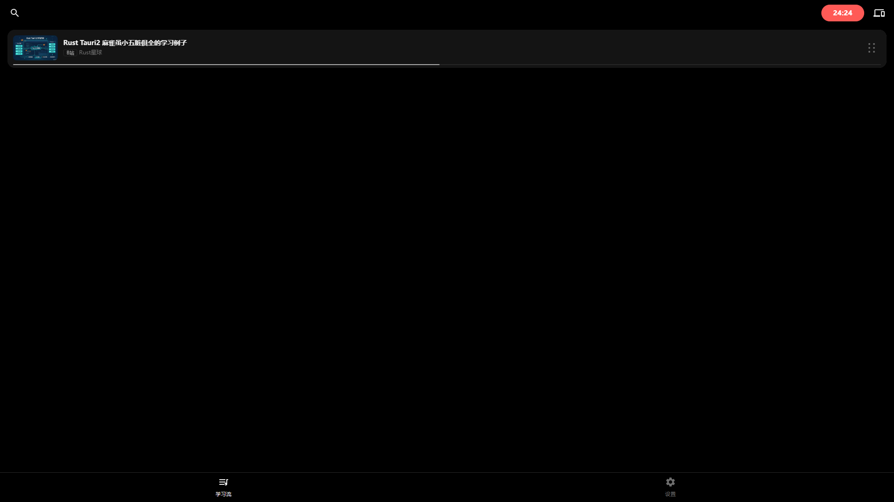
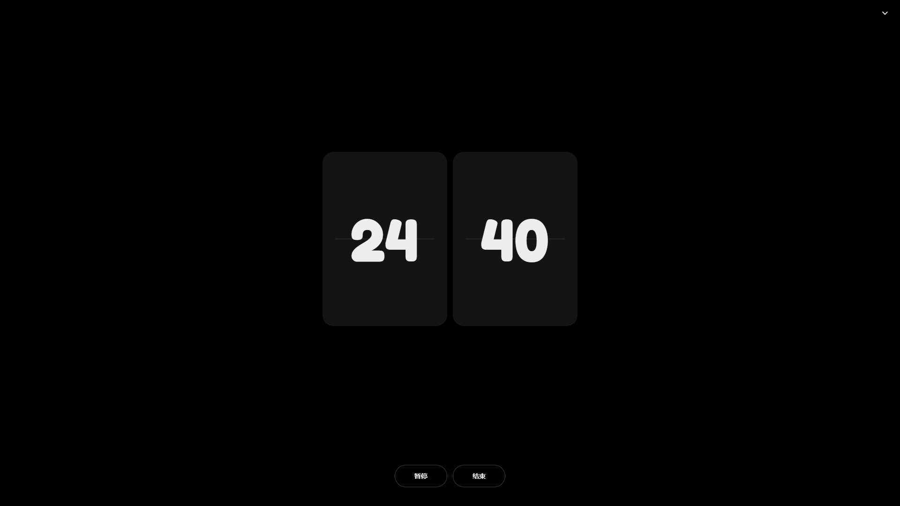
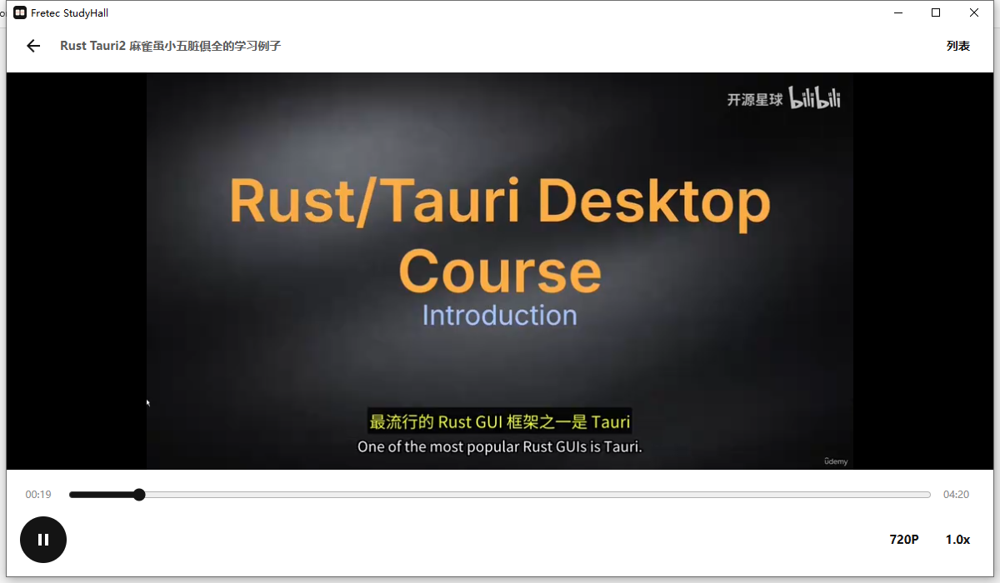
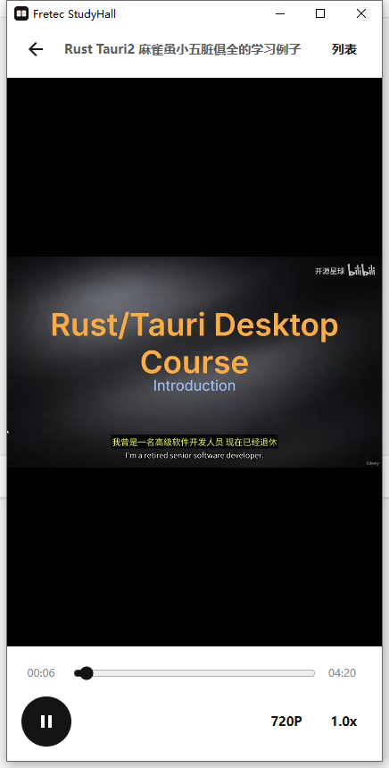
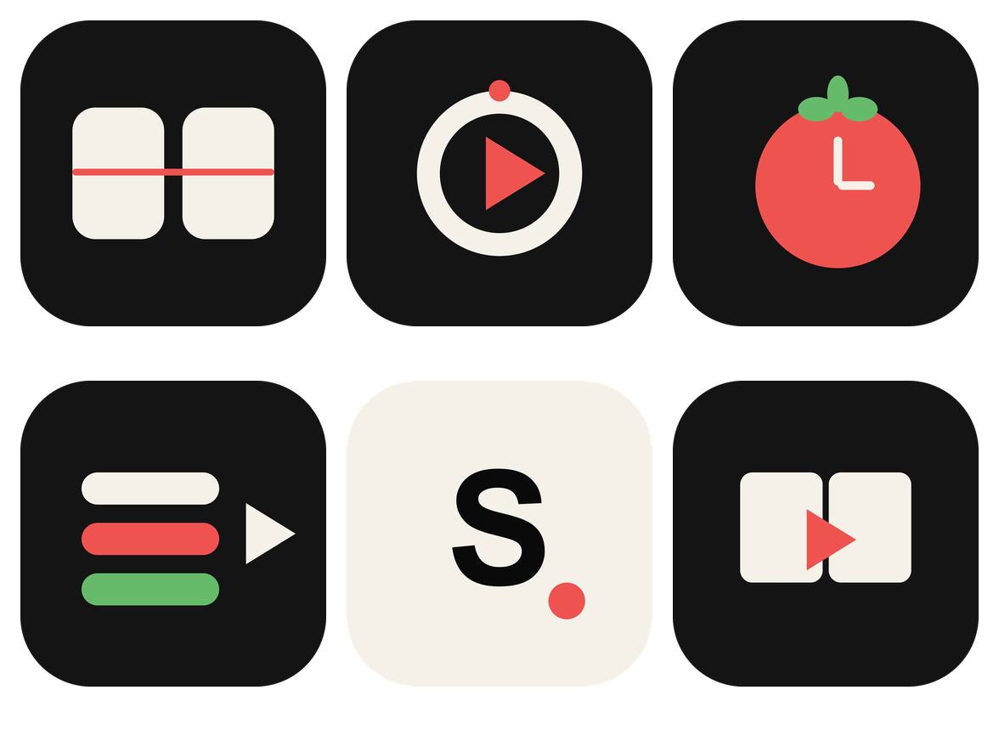

# Fretec StudyHall

一个番茄钟加学习流的桌面/移动应用，用 Rust + Tauri v2 写，一套代码构建 Windows、Linux 和 Android。界面是单色，默认浅色，可以在设置里切成深色或跟随系统。右上角是计时胶囊，底部是学习流和设置两个页面，学习流里可以放 B 站视频，点开就能在应用内播放。

现在做出来的东西：

- 计时：专注 25 分钟、休息 5 分钟循环，自动切换。点胶囊会从胶囊位置长出一块纯黑铺满全屏，再点收回去。胶囊颜色表示状态：默认是未开始，红色是专注，绿色是休息。
- 专注锁定：桌面端计时开始后窗口全屏并置顶，关闭按钮在计时中不生效；Android 进入沉浸全屏并申请屏幕固定，返回键在计时中不会退出应用，结束后自动恢复。
- 学习流：卡片可以长按拖动排序，右滑超过 30% 会停在滑开状态，点删除移除。卡片底部有播放进度条。
- 播放器：B 站视频走本地代理，补上 Referer 和 UA；画质 360P / 720P / 1080P，倍速 0.5x 到 2.0x；返回后播放器收到迷你条里，进度按秒记在本地，下次打开接着播。搜索结果点一下就直接试看，点“添加”才进学习流。播放器里有播放列表，打开学习流条目时列表是学习流，从搜索打开时列表是当前搜索结果。视频区随窗口伸缩，宽窗口铺满高度，窄窗口按比例留黑边，控制条固定在底部。
- 返回：桌面端 Esc 或播放器返回键逐层关闭浮层；Android 返回键先关浮层，再切回学习流，计时结束后才允许退到桌面。
- 搜索：顶栏左上角打开搜索层，只搜哔哩哔哩。B 站请求带 WBI 签名，500ms 防抖，滚动分页，最多 100 条。计时中不能添加，但可以点结果直接播放。搜索、添加和播放都不需要登录 B 站账号。
- 局域网：UDP 广播发现，TCP 长连接，只同步倒计时状态，最多 4 台。计时进行中不允许新建连接，学习流和播放进度不同步。
- 托盘和通知：Windows/Linux 关窗口后留在托盘，单击显示或隐藏；Android 用前台服务维护常驻通知，通知标题显示专注或休息状态和剩余时间。
- 设置：外观（浅色 / 深色 / 跟随系统）、关闭窗口行为（桌面）、权限（Android，通知权限和专注锁定说明放在一起）、检查更新和关于。检查更新读 Gitee 的 release 接口，只做版本比对，安装包需要手动去发行页下载。
- 图标：M3 风格，默认用深色底、双翻页卡和红色分隔线的方案；其他候选图放在 `out/icons/`，换图标用 `scripts/gen-icons.py` 里的变体。

## 界面

浅色是默认外观，也能切到深色或跟随系统。












## 目录

```
src/                     前端，TypeScript，没有框架
src/styles/tokens.css    颜色、圆角、字号等设计令牌
src-tauri/               Rust 侧和 Tauri 配置
src-tauri/src/bili/      B 站搜索、取流与登录（登录界面已移除）
src-tauri/src/netease/   网易云接口（界面已移除，代码保留）
src-tauri/src/lan/       局域网发现和倒计时同步
src-tauri/src/proxy.rs   127.0.0.1 上的视频代理
src-tauri/src/timer.rs   计时状态机
plugins/                 Android 前台服务插件（Kotlin）
scripts/                 打包、初始化环境、Gitee 绑定、颜色令牌检查
out/                     安装包输出目录
```

## 构建

需要 Node 20 以上、pnpm、Rust stable。Windows 还要 MSVC Build Tools 和 WebView2；Linux 要 webkit2gtk 4.1、libappindicator3、librsvg2、patchelf；Android 要 JDK 17、Android SDK 36、NDK r27 和四个 Android target。

前端：

```powershell
pnpm install
pnpm typecheck
pnpm build
cargo test --manifest-path src-tauri/Cargo.toml
cargo clippy --manifest-path src-tauri/Cargo.toml --all-targets -- -D warnings
```

Windows 安装包：

```powershell
powershell -ExecutionPolicy Bypass -File scripts/package-windows.ps1
```

脚本会先把 NSIS 3.13 和插件放到 `%LOCALAPPDATA%\tauri\NSIS`（本机访问不了 GitHub，走 gh-proxy 下载并校验 SHA1），再执行 `pnpm tauri build --bundles nsis`，最后把安装包复制到 `out/`。

Android：

```powershell
powershell -ExecutionPolicy Bypass -File scripts/setup-android.ps1
pnpm tauri android init
powershell -ExecutionPolicy Bypass -File scripts/package-android.ps1
```

这台机器没开 Windows 开发者模式，Tauri CLI 往 jniLibs 放 .so 时要用符号链接，会失败。所以我改成手动跑一遍：先 `cargo build --target aarch64-linux-android --release --lib`，把 `.so` 复制进 `src-tauri/gen/android/app/src/main/jniLibs/arm64-v8a/`，再把 `buildSrc` 里 `BuildTask.kt` 的执行体改成空实现，直接 `gradle assembleArm64Release`。签名配置写在 `gen/android/app/build.gradle.kts` 里，读的是 `keystore.properties`。这些文件都在 `gen/` 下，不进 git；重新 init 后要重新改一遍。开启开发者模式的机器直接 `pnpm tauri android build --apk` 就行。

Linux：

```bash
sudo apt-get install -y libwebkit2gtk-4.1-dev libappindicator3-dev librsvg2-dev patchelf libgtk-3-dev
pnpm install && pnpm tauri build --bundles deb,appimage
```

`.github/workflows/build.yml` 里有一套三端的构建流程，本机没有 Linux 环境，没跑过。

另外，这台机器装 VS Build Tools 时被 Microsoft CDN 卡住了，所以桌面构建用的是另一种办法：xwin 下载 MSVC CRT 和 Windows SDK，rustup 自带的 `rust-lld` 改名成 `lld-link.exe` 当链接器，`rc.exe` 从 NuGet 的 `Microsoft.Windows.SDK.BuildTools` 里取，`scripts/dev-env.ps1` 负责设置这些环境变量。`src-tauri/vendor/vswhom-sys` 是为了绕开 `embed-resource` 对 C++ 编译器的依赖写的空实现。正常装了 VS Build Tools 的机器不需要这些。

`src-tauri/build.rs` 没有用 tauri-build 默认的 manifest 嵌入，因为那个只链接到二进制目标，单元测试里链接 tauri 会找不到 Common Controls v6，一启动就 `STATUS_ENTRYPOINT_NOT_FOUND`。现在改成对所有 Windows 链接目标统一用 `rustc-link-arg` 嵌入 `windows-app-manifest.xml`。

## 依赖

前端：`@tauri-apps/api` 调 Rust 命令和事件；`@tauri-apps/cli` 是构建工具；`qrcode` 生成登录二维码；`vite` 构建；`typescript` 做类型检查。

Rust：`tauri` 提供窗口、托盘、命令和事件；`tokio` 跑异步任务、局域网和计时循环；`reqwest` 请求第三方接口（桌面用系统 TLS，Android 用 rustls）；`axum` 起本地代理；`serde`/`serde_json` 处理数据和本地 JSON；`md5` 做 WBI 签名和网易云密码摘要；`aes`/`cbc` 做 weapi 加密；`rsa`/`num-bigint` 做网易云裸 RSA 和 B 站 RSA-OAEP；`base64`、`urlencoding`、`percent-encoding` 做编码；`uuid` 生成条目和代理 key；`thiserror` 统一错误。

字体是 Fredoka（SIL OFL 1.1，见 `public/fonts/OFL.txt`），只用在翻页钟数字上。

## 数据

Windows 存在 `%APPDATA%\com.fretec.studyhall\`，Android 在应用私有目录。`flow.json` 存学习流、排序和播放进度，`device.json` 存设备名，`settings.json` 存外观和关闭行为。播放和搜索都在 Rust 侧完成，不依赖账号 cookie。

## 本机验证情况

Windows 上跑过：启动、两个页面切换、胶囊展开和收回、胶囊颜色、开始/暂停/继续、B 站真实搜索结果、结果直接播放、播放列表切歌、卡片打开播放器并播放、返回后迷你条出现、`flow.json` 里进度正常写入；播放器在 436×859 和 1200×700 两种窗口下都能自适应；浅色和深色切换、检查更新、关闭窗口行为也实际点过。`cargo test` 50 个测试通过，`cargo clippy -D warnings` 通过，`pnpm typecheck` 和 `pnpm build` 通过，`node scripts/check-tokens.mjs` 通过。产物是 `out/Fretec-StudyHall-0.4.0-beta.1-x64-setup.exe` 和 `out/Fretec-StudyHall-0.4.0-beta.1-arm64.apk`。

没条件验证的：Android 真机上的全屏锁定、屏幕固定、返回键、通知和权限弹窗；局域网两台设备之间的发现和同步（只有代码和单元测试）；托盘悬停提示的实际效果；Linux 打包。

## 已知问题

- B 站用的都是非官方接口，会改版，也可能触发风控。出错时会给出中文提示，不会崩。
- 网易云和 B 站登录已经不做入口；旧的登录代码还留在 Rust 侧，但界面上不再出现。
- Android 的屏幕固定会弹系统确认，用户拒绝时只保留全屏，返回键仍然会被拦截到计时结束。
- 部分 Linux 发行版的 WebView 没有 H.264 解码，B 站视频可能放不了。
- 局域网同步是明文 JSON，没有认证，只适合可信的内网。
- 翻页钟数字用的是随包字体，其他文字走系统字体。

## 授权

Fredoka 字体按 SIL OFL 1.1 使用。代码目前没有声明开源协议。

